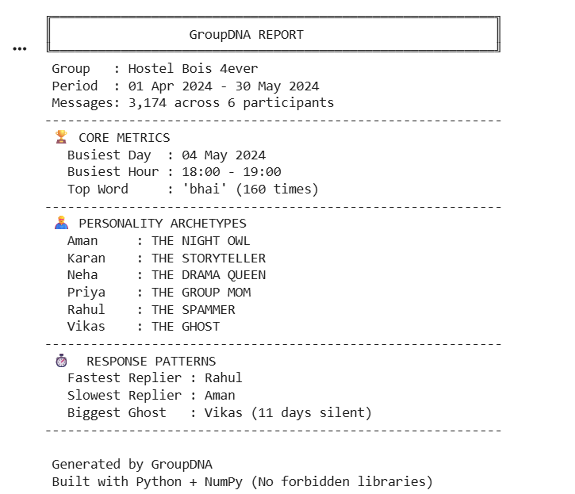

# GroupDNA - WhatsApp Chat Analyzer

A Python-based data analytics tool that parses a WhatsApp chat export and generates a personality and activity report. Built entirely using Python fundamentals and NumPy.

## 📸 Output Screenshot

## 🛠️ Constraints (What I did NOT use)
To prove fundamental programming skills, I built this without the following:
- ❌ No `pandas` (used native Python lists and dicts)
- ❌ No `matplotlib` or `seaborn` (used text-based visualizations)
- ❌ No `re` (regex) for parsing
- ❌ No `collections.Counter`

## 🚀 Features Built
1. **Chat Parser:** Handles system messages, media stubs, and deleted messages.
2. **Group Overview:** Message counts and percentages per person.
3. **Activity Heatmap:** 6x24 matrix built with NumPy to find night owls.
4. **Top Words:** Custom tokenizer and stop-word filter with bar chart rendering.
5. **Response Times:** Uses `datetime` to find fastest repliers and longest silent streaks.
6. **Archetypes:** Assigns titles like "The Ghost", "The Spammer", and "The Night Owl" based on user behavior.

## 💻 How to Run
1. Clone this repository or download the `.ipynb` file.
2. Open the notebook in Google Colab or Jupyter Notebook.
3. Ensure `hostel_bois.txt` is in the same directory as the notebook.
4. Run all cells sequentially (Runtime -> Run All).
